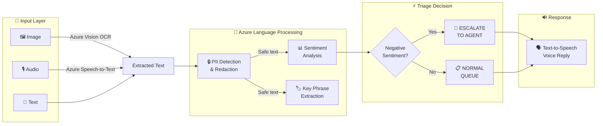

<div align="center">

```
╦ ╦╦ ╦╔═╗╔═╗╦═╗╔═╗╦ ╦╔═╗╔═╗╔═╗╦═╗╔╦╗
╠═╣╚╦╝╠═╝║╣ ╠╦╝╚═╗║ ║╠═╝╠═╝║ ║╠╦╝ ║
╩ ╩ ╩ ╩  ╚═╝╩╚═╚═╝╚═╝╩  ╩  ╚═╝╩╚═ ╩
━━━━━━━━━━━━━━━━━━━━━━━━━━━━━━━━━━━━━
   ⚡  AI-Powered Support Triage  ⚡
```

### Intelligent Customer Support Triage — Redact, Analyze, Route, Respond


</div>

**HyperSupport** is an AI-powered customer support triage system built on Azure AI Foundry services. It ingests customer input from **Text**, **Image** (OCR), or **Audio** (Speech-to-Text), automatically detects and redacts PII, analyzes sentiment, extracts key phrases, routes urgent negative tickets to human agents, and generates Text-to-Speech replies — all through a sleek Streamlit dashboard. Built as an **AI-901 (Azure AI Fundamentals)** university project, it demonstrates a production-style responsible AI pipeline end-to-end.

---

## 📑 Table of Contents

- [Features](#-features)
- [Prerequisites](#-prerequisites)
- [Installation](#-installation)
- [Usage](#-usage)
- [Configuration](#-configuration)
- [Project Structure](#-project-structure)
- [Pipeline Architecture](#-pipeline-architecture)
- [AI-901 Syllabus Mapping](#-ai-901-syllabus-mapping)
- [License](#-license)

---

## ✨ Features

| Capability | Description |
|:---|:---|
| 🔤 **Multi-Modal Input** | Accepts plain text, image uploads (PNG/JPG), and WAV audio files |
| 🔒 **PII Detection & Redaction** | Automatically identifies names, phone numbers, and other personal data — masks them before any downstream processing |
| 📊 **Sentiment Analysis** | Classifies customer tone as Positive, Neutral, or Negative with confidence scores |
| 🏷️ **Key Phrase Extraction** | Surfaces the core topics and concerns from each ticket |
| 🚨 **Smart Routing** | Negative-sentiment tickets are instantly escalated to a human agent; everything else goes to the standard queue |
| 👁️ **Image OCR** | Reads text from screenshots, receipts, or photos via Azure Computer Vision |
| 🎙️ **Speech-to-Text** | Transcribes uploaded `.wav` audio calls into text for analysis |
| 🔊 **Text-to-Speech Replies** | Generates a spoken response confirming ticket status (multiple voice options) |
| 🖥️ **Interactive Dashboard** | Real-time Streamlit web UI with metrics, bar charts, and audio playback |

---

## 📋 Prerequisites

- **Python** 3.10+
- **Azure AI Foundry** resource with the following services enabled:
  - Text Analytics (Language)
  - Computer Vision (Image Analysis)
  - Speech Services
- **Azure API Key** for the Foundry resource
- **pip** (bundled with Python)

---

## 🚀 Installation

```bash
# 1. Clone the repository
git clone https://github.com/<your-username>/HyperSupport.git
cd HyperSupport/ai901-triage-agent

# 2. Create and activate a virtual environment
python -m venv .venv
source .venv/bin/activate        # macOS / Linux
# .venv\Scripts\activate         # Windows

# 3. Install dependencies
pip install -r requirements.txt

# 4. Set your Azure Foundry API key
export FOUNDRY_API_KEY="your-azure-api-key-here"
```

---

## 🎯 Usage

### Streamlit web app (recommended)

```bash
streamlit run app.py
```

The dashboard opens at `http://localhost:8501`. Use the sidebar to enter your API key and select a voice, then switch between the **Text**, **Image**, and **Audio** tabs to analyze tickets.

### CLI triage agent

```bash
python triage_agent.py
```

Runs a quick triage on a sample complaint. Place `sample_call.wav` or `sample_screenshot.png` in the same directory to also test audio and image pipelines.

---

## ⚙️ Configuration

| Variable | Description | Default | Required |
|:---|:---|:---|:---|
| `FOUNDRY_API_KEY` | Azure AI Foundry resource API key | — | **Yes** |

The API key can be provided in two ways:

1. **Environment variable** — `export FOUNDRY_API_KEY="..."` before running.
2. **Sidebar input** — paste it directly in the Streamlit sidebar at runtime.

> [!NOTE]
> The endpoint and region are configured in the source code (`ENDPOINT`, `REGION = "eastasia"`). Update them if you deploy your own Azure AI Foundry resource in a different region.

---

## 🗂️ Project Structure

```
HyperSupport/
└── ai901-triage-agent/
    ├── app.py               # Streamlit web UI — full interactive dashboard
    ├── triage_agent.py       # CLI triage agent — headless text/image/audio pipeline
    ├── requirements.txt      # Python dependencies
    └── .gitignore            # Ignores .venv, .env, __pycache__
```

---

## 🔀 Pipeline Architecture

The core triage flow follows a linear pipeline regardless of input modality:



**How it works:**

1. **Ingest** — The customer submits a complaint via text, an image (screenshot/receipt), or a `.wav` audio recording.
2. **Normalize** — Images are processed through **Azure Computer Vision OCR** and audio through **Azure Speech-to-Text** to produce raw text.
3. **Redact** — **Azure PII Detection** scans the text, identifies personal data (names, phone numbers, emails), and replaces them with masks.
4. **Analyze** — The redacted text is passed through **Sentiment Analysis** and **Key Phrase Extraction** in parallel.
5. **Route** — If sentiment is `negative`, the ticket is flagged `HIGH_URGENCY_ESCALATE` and routed to a human agent. Otherwise, it enters the `STANDARD_QUEUE`.
6. **Respond** — A confirmation message is generated and spoken aloud via **Azure Text-to-Speech**.

---

## 🎓 AI-901 Syllabus Mapping

This project demonstrates the following **Azure AI Fundamentals (AI-901)** concepts in practice:

| AI-901 Topic | Where Used in This Project |
|:---|:---|
| **Computer Vision — OCR** | Reads text from uploaded screenshots and receipts via `ImageAnalysisClient` with `VisualFeatures.READ` |
| **Speech Services — STT** | Transcribes `.wav` audio calls into text using `SpeechRecognizer.recognize_once()` |
| **Speech Services — TTS** | Generates spoken voice replies via `SpeechSynthesizer.speak_text_async()` with neural voices |
| **NLP — Sentiment Analysis** | Classifies customer tone (positive/neutral/negative) with confidence scores using `analyze_sentiment()` |
| **NLP — Key Phrase Extraction** | Surfaces core complaint topics using `extract_key_phrases()` |
| **NLP — PII Detection** | Identifies and redacts personal data using `recognize_pii_entities()` |
| **Responsible AI** | Masks PII before analysis to protect privacy; escalates negative cases for human review rather than auto-resolving |

---

## 📄 License

> [!IMPORTANT]
> No license file was detected in this repository. This means the project is under exclusive copyright by default. If you intend to share or open-source this project, consider adding a license (e.g., MIT, Apache 2.0).

---

<div align="center">

Built with 🧠 Azure AI Foundry and ❤️ Streamlit

**AI-901 · Azure AI Fundamentals**

</div>
